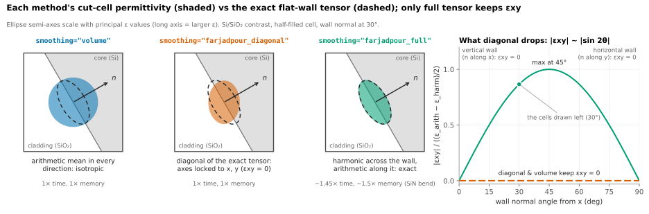
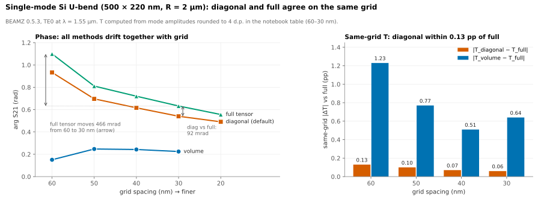
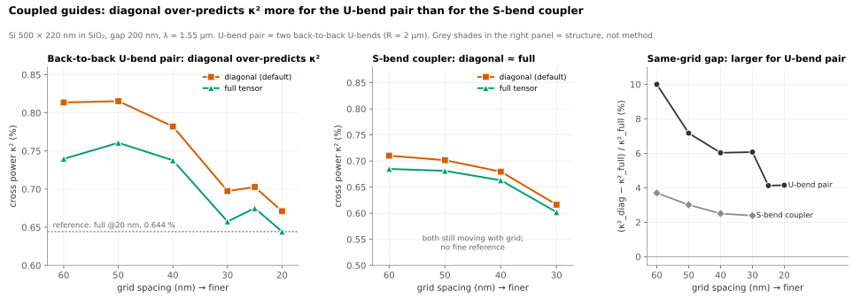
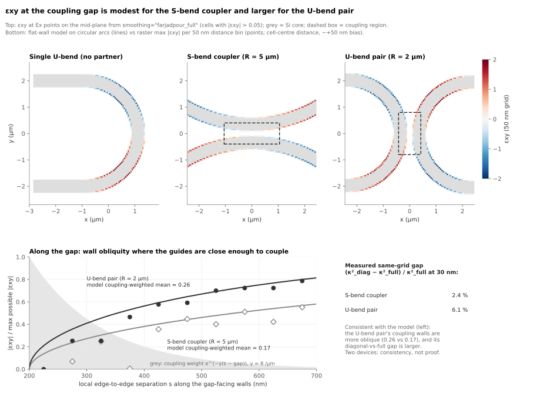
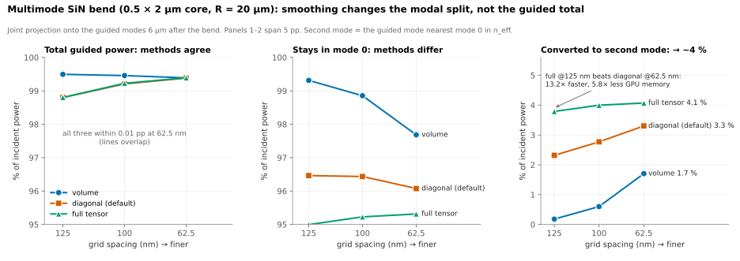

# Choosing interface smoothing

Start with `farjadpour_diagonal`, then compare it with `farjadpour_full` at the
working grid on the observable that matters. Switch if the difference exceeds
your tolerance. The [tutorial](../../examples/notebooks/interface_smoothing_choice.ipynb)
contains runnable figures and examples; the [RTX 3090 comparison](CPML_CONSTANTS_RTX3090.md)
measures this PR's memory optimization independently of smoothing accuracy.

## What changes at an interface

For an isotropic two-material flat interface with normal **n**, the effective
cut-cell tensor is `ε = ε_harm n nᵀ + ε_arith (I − n nᵀ)`.
`volume` uses the arithmetic mean in all directions; `farjadpour_diagonal` keeps
only the tensor's diagonal; `farjadpour_full` retains its off-diagonal terms.
Diagonal and full agree for grid-aligned walls. At oblique walls, full couples
neighboring displacement-field components and costs more time and memory per cell.
See [Farjadpour et al. (2006)](https://doi.org/10.1364/OL.31.002972) and
[Kottke et al. (2008)](https://doi.org/10.1103/PhysRevE.77.036611).

## Measured accuracy

These four 3D examples were measured on an RTX 5070 Laptop (8 GB). Si structures
used released BeamZ 0.5.3 / JAX 0.10.2. SiN accuracy and timing used v0.5.2 at
`8ab968ac`, Python 3.11.15, JAX 0.9.0, x64 enabled with float32 material arrays;
SiN memory was remeasured on `80ef0182` with and without scalar CPML constants.
Percentage points are abbreviated pp.

| Structure | Observable and same-grid diagonal/full difference | Interpretation |
|---|---|---|
| Single-mode Si U-bend, 500 × 220 nm, R = 2 µm | Transmission ≤ 0.133 pp; phase 166 → 65 mrad at 60 → 20 nm | Refinement moves phase more; diagonal is adequate for transmission |
| Si S-bend coupler, R = 5 µm, 200 nm gap | Cross power differs by 2.4–3.7% relative | Grid dependence exceeds the method difference |
| Back-to-back Si U-bends, R = 2 µm, 200 nm gap | Diagonal cross power is 4–10% higher | Full can reach a given reference error on a coarser grid |
| Multimode SiN bend, 0.5 × 2 µm, R = 20 µm | Second-mode conversion is 3.3% / 4.1% at 62.5 nm | Modal splitting is more sensitive than total guided power |

For the single Si U-bend, refining 60 → 30 nm moves diagonal/full phase by
390–470 mrad, versus their 92–166 mrad same-grid difference. Volume's nearly
stationary phase reflects cancellation of wall and grid errors, not demonstrated
accuracy. Full costs roughly 1.5–1.9× the GPU time per grid in these measurements.

For the U-bend pair, the reference is full tensor at 20 nm (0.644% cross power):

| Grid, nm | Cross power %, diagonal / full | GPU time s, diagonal / full | Peak GB, diagonal / full |
|---:|---:|---:|---:|
| 60 | 0.814 / 0.740 | 3 / 5 | 0.14 / 0.17 |
| 40 | 0.782 / 0.738 | 20 / 31 | 0.45 / 0.58 |
| 30 | 0.697 / 0.658 | 71 / 98 | 1.12 / 1.36 |
| 25 | 0.703 / 0.675 | 158 / 231 | 1.93 / 2.49 |
| 20 | 0.671 / 0.644 | 386 / 564 | 3.66 / 4.64 |

Against that reference, full at 30 nm has 2% error versus diagonal's 4% at 20 nm,
using 3.9× less time and 2.7× less memory. The reference favors full. Against
diagonal's own 20 nm result, the comparable pair is diagonal at 25 nm versus
full at 30 nm, giving a smaller 1.6× time saving. Nonmonotonic behavior at 25 nm
shows sensitivity to gap placement on the grid.

The gap-facing walls of the U-bend pair are more oblique than those of the
S-bend coupler. Their off-diagonal permittivity maps suggest a mechanism for the
different coupling sensitivity, but this is a correlation between two devices.

The SiN device uses n = 2.0 in n = 1.44 oxide, λ = 1.55 µm, a 31 × 34 × 10 µm
domain, and 800 fs duration. Mode-0 power is measured 6 µm after the 90° bend,
normalized to incident modal power and jointly projected onto six bound modes.
Total guided power agrees to about 0.01 pp at 62.5 nm; second-mode conversion differs:

| Grid, nm | Volume | Diagonal | Full |
|---:|---:|---:|---:|
| 125 | 0.2% | 2.3% | 3.8% |
| 100 | 0.6% | 2.8% | 4.0% |
| 62.5 | 1.7% | 3.3% | 4.1% |

Full at 125 nm uses 13.2 s / 0.73 GB versus diagonal at 62.5 nm's 174.2 s /
4.29 GB with the memory fix: 13.2× faster and 5.9× less memory. Their mode-0
errors against full at 62.5 nm are 0.32 and 0.76 pp. The reference's 0.74 pp
screening margin makes these two results inseparable; this supports comparable
accuracy, not an independent proof of full tensor's absolute error.

## Uniform CPML constants

For 3D all-CPML boundary configurations, the fix stores exactly uniform
conductivity/permeability and matching `sig_*` / `mu_h*` arrays as 0-d scalars.
Compiled consumers must broadcast them when arrays are needed. Permittivity and
nonuniform properties retain their arrays; sponge, mixed-boundary and 2D paths
keep their established representation. No smoothing algorithm changes.

On the SiN bend, peak live GPU memory on `80ef0182` versus the fix fell from
0.78 → 0.54 GB (diagonal, 125 nm), 1.07 → 0.73 GB (full, 125 nm), and
5.62 → 4.29 GB (diagonal, 62.5 nm). The full 62.5 nm run changed from OOM to
6.43 GB within the laptop's 6.87 GB allocation budget. Measured guided powers
and flux were bit-identical where both versions completed. The separate
[RTX 3090 study](CPML_CONSTANTS_RTX3090.md) also validates native CUDA execution.

## Limits and reproduction

The tutorial reproduces the single Si U-bend and U-bend pair at its configured
grids. The S-bend, fine-grid references, and SiN runners/raw data are not included
in this repository; their quoted measurements cannot be fully reproduced from a
fresh checkout. SiN working files were on `cdaunt/beamz`, branch
`feat/fit-interface-prototype`, in `scripts/run_sin_gpu_study.py` and
`docs/explicit_anisotropic_experiment.ipynb`.

The accuracy references use the same solver and favor full tensor. Four devices
do not establish a general speedup or tolerance, and the proposed connection
between oblique gap walls and coupling sensitivity is correlational. Radiation
accounting, controlled orientation comparisons and other geometries were not
validated. The local RTX 3090 regression results compare revisions of the same
workload; they do not independently validate these accuracy claims.
