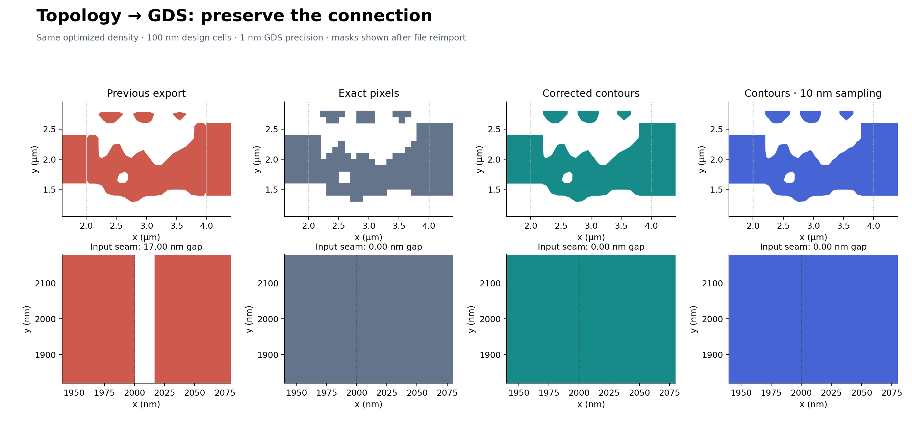
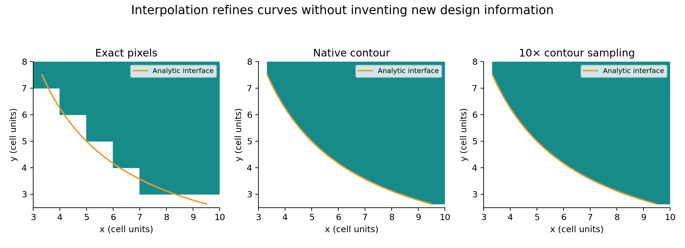

# Topology-to-GDS export comparison

This is a reproducible export check for issue #331, generated by
[`topology_gds_export.py`](../../optimization/topology_gds_export.py). It uses one
optimized density for every export variant. The previous exporter is reproduced
by its original contour-padding formula; the other variants use the current API.



The old contour closes 16.67 nm inside a solid 100 nm boundary cell. After GDS
quantization to 1 nm, the input gap is **17 nm**. Exact pixels, corrected contours,
and refined contours all have **zero gap** across the same input connection.
The files retain one hole and three isolated islands; no island cleanup is
applied. The old layout has six disconnected components because both guides
are detached; the corrected layouts have four.

## Reimport and simulate the written mask

Every GDS was read independently through KLayout. Its polygons were reconstructed
as BeamZ geometry at their absolute physical coordinates and simulated again.
The values below are mode-1 output power divided by forward mode-0 input power
at 1.55 µm; percentages are rounded for display.

| Geometry | GDS, 100 nm mesh | Before GDS, 50 nm mesh | GDS, 50 nm mesh | GDS change, percentage points |
|---|---:|---:|---:|---:|
| Previous export | 74.212% | 64.101% | 64.107% | +0.0065 |
| Exact pixels | 71.500% | 60.322% | 60.322% | 0.0000 |
| Corrected contours | 75.534% | 64.540% | 64.544% | +0.0034 |
| Contours, 10 nm sampling | 75.800% | 64.453% | 64.444% | −0.0088 |

The final continuous-density reference gives **76.367%** on the 100 nm design
mesh. Thresholding, interpolation, mesh refinement, and file quantization are
separate changes. The substantial 100-to-50 nm change means this example does
**not** establish mesh convergence. Finer contour sampling gives smoother
geometry but does not necessarily increase transmission.

The maximum measured geometric displacement from file writing/reimport was
**0.494 nm** for these layouts. The largest transmission change caused by the
GDS round trip on a fixed mesh was **0.0088 percentage points**.

## Interpolation detail



This second comparison uses an analytic bilinear density field, with the exact
interface drawn in gold. It isolates interpolation behavior from optimization
and FDTD. `sample_spacing` refines the same continuous reconstruction; it does
not introduce another smoothing filter.

## Reproduce

From the repository root:

```bash
JAX_PLATFORMS=cpu uv run --extra gds python examples/optimization/topology_gds_export.py
```

Outputs go to `results/gds-export/`. Add `--resume` to reuse that directory's
checkpoint and repeat export/reimport verification without repeating optimization.

Recorded on 2026-10-11 from the `fix/331-topology-gds` implementation based on
BeamZ `abe5e225`, using Python 3.11.15, JAX 0.9.0, NumPy 2.4.1,
scikit-image 0.26.0, Shapely 2.1.2, gdsfactory 8.18.2, and KLayout 0.30.6.
The model is an illustrative 2D TM mode converter with relative permittivities
1 and 4, a 6 × 4 µm domain, 100 nm design cells, a 200 fs simulation, and CPML.
It uses 24 Adam steps, a 200 nm filter, beta continuation from 1 to 12, fixed
solid/cladding port cells, a 0.5 export threshold, and 1 nm GDS precision.

- [Exact-pixel GDS](pixel_exact.gds)
- [Corrected-contour GDS](contour.gds)
- [Refined-contour GDS](refined.gds)
- [Previous-export GDS](legacy.gds)
- [Full measurements](measurements.json)
- [Final parameters and physical density](density.npz)
